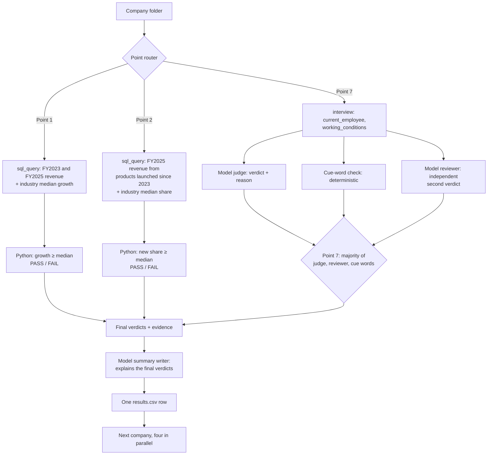

# FTEC5660 Homework 3: Fisher's 15-Point Investment Agent

Build a LangChain agent that researches a company with tools and applies the
framework from Philip Fisher's *Common Stocks and Uncommon Profits* (Part One,
Chapter 3 "What to buy: the fifteen points to look for in a common stock", and
Chapter 4 "What to buy: applying this to your own needs"). You choose 3 of
Fisher's 15 points and decide yourself what PASS means for each. For every
company your agent gives a PASS/FAIL verdict on your 3 points and a short
summary.

The companies are fictional, so the model cannot answer from memory. Unlike a
pile of reports, the evidence is spread over three sources, and your agent has
to go and get it with tools, the way Fisher's "scuttlebutt" method sends an
investor to talk to customers, competitors, suppliers and staff.

## Data and tools

`public_test/` has one folder per company. Your code receives four tools per
company (built by the provided code in `hw3.py`):

| Tool | What it gives you |
| --- | --- |
| `list_documents()` | the company's six documents and their dates |
| `read_document(name)` | one document: the 2025 letter to shareholders, four earnings calls (Q3 2025 to Q2 2026) and a news file (July 2025 to July 2026) |
| `sql_query(query)` | one read-only SQLite query on the company's database; at most 50 rows come back, so use `SUM`, `GROUP BY` and `WHERE` |
| `interview(role, topic)` | what one person says about the company; at most **10 interviews per company** |

The documents are what management says. Management's own claims (such as "we
have never cut research" or "our people are our greatest strength") are not
evidence on their own: check them against the database and the interviews.

**Database tables** (amounts in USD thousands; dates `YYYY-MM-DD`, months
`YYYY-MM`, quarters like `2025Q3`; the fiscal year is the calendar year):

| Table | Columns |
| --- | --- |
| `company` | name, industry |
| `industry_medians` | industry, revenue_growth_2y_pct, new_product_share_pct, new_product_sales_per_rd, operating_margin_pct (one row per industry; use the row for the company's own industry) |
| `orders` | order_id, order_date, product, customer, amount, note (about 3,000 to 4,000 orders from January 2023 to June 2026; revenue is the sum of order amounts) |
| `products` | product, launch_date |
| `monthly_costs` | month, cost_of_sales, selling_admin, research_development |
| `quarterly_cash` | quarter, operating_cash_flow, capex, cash_end |
| `capex_plan` | year, planned_capex (2026 to 2028) |
| `returns` | month, units_shipped, units_returned |
| `insider_trades` | trade_date, person, title, side (`buy` or `sell`), shares, price |

**Terms used in the data.**

| Term | Meaning |
| --- | --- |
| FY2025 | Fiscal year 2025. Here the fiscal year is the calendar year, so FY2025 is January to December 2025. |
| Quarter | Three months of the year: Q1 is January to March, Q2 April to June, Q3 July to September and Q4 October to December. The database writes `2025Q3`; the documents write "third quarter 2025". |
| Amounts | The database is in **USD thousands** (676,100 means US$676.1 million). The documents use USD millions. |
| Revenue | Money from sales: the sum of `amount` in `orders`. |
| Cost of sales | The cost of making the products that were sold. |
| Selling and admin | The cost of selling and of running the company (sales staff, offices, management). |
| R&D | Research and development spending, mainly on new products. |
| Operating margin | Operating profit as a share of revenue: (revenue − cost of sales − selling and admin − R&D) ÷ revenue. |
| Operating cash flow | Cash that the day-to-day business brings in during a quarter. |
| Cash at the end of a quarter | The cash the company holds on the last day of that quarter (`cash_end`). |
| Capex | Capital expenditure: spending on factories, machines and other long-term assets. `capex_plan` holds the planned capex for 2026 to 2028. |
| Return rate | Units returned ÷ units shipped, from the `returns` table. |
| Industry median | The middle value for companies in the same industry, from `industry_medians`. |
| Insider | A director or senior manager of the company. `insider_trades` lists the shares they bought (`buy`) or sold (`sell`). |
| Earnings call | A meeting each quarter where management presents the quarter's results to investors. Each call quotes that quarter's revenue. |

**Interviews.** Roles: `customer`, `current_employee`, `former_employee`,
`competitor`, `supplier`. Topics: `sales_team`, `working_conditions`,
`top_management`, `decision_making`, `competitive_edge`. Only some people know
about each topic; the others say they can't comment, and that answer still
uses up one interview.

| Topic | Who knows about it |
| --- | --- |
| `sales_team` | customer, competitor |
| `working_conditions` | current_employee, former_employee |
| `top_management` | former_employee, supplier |
| `decision_making` | supplier, customer |
| `competitive_edge` | competitor, customer |

People who know about a topic always agree with each other, so one good answer
is enough.

## Choose your 3 points and your rules

Pick any 3 of Fisher's 15 points and write them in `CHOSEN_POINTS` near the
top of `hw3.py`, e.g. `CHOSEN_POINTS = [1, 7, 15]`. The full questions are in
`FISHER_POINTS` in `hw3.py` and in the book.

| # | Fisher's point | Where the evidence is |
| --- | --- | --- |
| 1 | Market potential for sales growth | database |
| 2 | New products as current lines mature | database |
| 3 | Effective research and development | database |
| 4 | Above-average sales organization | interviews (`sales_team`) |
| 5 | Worthwhile profit margin | database |
| 6 | Maintaining or improving margins | database |
| 7 | Labour and personnel relations | interviews (`working_conditions`) |
| 8 | Executive relations | interviews (`top_management`) |
| 9 | Depth of management | interviews (`decision_making`) |
| 10 | Cost analysis and accounting controls | earnings calls, checked against the database |
| 11 | Advantage over competitors | interviews (`competitive_edge`) |
| 12 | Long-range outlook on profits | database |
| 13 | Growth without dilutive equity financing | database |
| 14 | Management talks freely about troubles | earnings calls, checked against the database |
| 15 | Management of unquestionable integrity | news file, checked against the database |

For each of your points, **you design the rule**: which evidence to use, what
to compute or whom to ask, and where the line between PASS and FAIL lies. PASS
means the company looks favourable on that point, as Fisher would see it.

We grade your verdicts against our own answer key. It uses one fixed rule per
point, which we do not publish, and the data never puts a company close to
the line of that rule, so a sensible reading of Fisher usually gives the same
answer. **Test your rules on the public answers**:
`public_test/ground_truth.json` gives the expected verdict on all 15 points
for each of the 20 public companies, and every point fails in 6 of them. If
your rule disagrees with the public answers, rethink it.

**Tip: calculate with tools, not in your head.** Do every sum, ratio and
comparison in SQL or Python, including the number of days between two dates
(SQLite's `julianday()` gives a date as a number of days).

## Student task

Fill in the three places in `hw3.py` marked `### YOUR CODE HERE`. You may add
imports, constants and helper functions above them, but do not change the
provided code below them:

- `CHOSEN_POINTS` lists your 3 points.
- `build_agent()` creates your model and anything else you need once.
- `analyze_companies(agent, companies)` receives
  `{company_folder: [list_documents, read_document, sql_query, interview]}`
  and returns, for every company,
  `{"points": {1: "PASS", 7: "FAIL", 15: "PASS"}, "summary": "..."}` (here with
  `CHOSEN_POINTS = [1, 7, 15]`).

Use the course techniques that fit your points: tool use for the database and
the interviews, planning which interviews to spend, routing each point to the
right source, prompt chaining, parallel calls, reflection to check your
answers, or a combination. Your code must read company data **only through
the four tools**; do not open `company.db` or `interviews.dat` yourself. Do
not hard-code folder names, company names or the public answers.

## Setup and public test

```bash
python3 -m venv .venv
source .venv/bin/activate
pip install -r requirements.txt
echo "DEEPSEEK_API_KEY=your_key_here" > .env
python3 hw3.py --data-folder public_test
```

Use your own DeepSeek API key (from https://platform.deepseek.com). The
required model is `deepseek-v4-flash`. We grade with our own key, so never put
a key in your code; `.env` must stay out of git.

The program creates `results.csv` with the columns `company`, `points`,
`points_correct`, `point_errors`, `interviews_used` and `summary`, and prints
the point score on your 3 points (the percentage after "balanced"). The point
score is the average of two shares: the share of truly passing verdicts that
you marked PASS and the share of truly failing verdicts that you marked FAIL.
For example, 90% and 60% give (90% + 60%) / 2 = 75%, and marking every point
PASS gives (100% + 0%) / 2 = 50%. Once `CHOSEN_POINTS` is set, the starter
runs before you add any API code (it returns no verdicts, so it scores 0%).

`public_test/ground_truth.json` gives the expected verdicts on all 15 points
for each public company. Grading uses a private set of about 20 unseen
companies with the same tools and the same answer key rules, but different
names and wording, and scores your 3 points only.

## Homework 3 solution:

`CHOSEN_POINTS = [1, 2, 7]`. The agent is in `hw3.py`; the Task 2 reflection is in
[REFLECTION.md](REFLECTION.md).

### My 3 points and rules

**Point 1 - Market potential for sales growth.** Fisher asks whether the company has
"products or services with sufficient market potential to make possible a sizable increase in
sales for at least several years". I chose it because it is the first filter in the book: a
company that cannot grow its revenue is unlikely to reward a long-term investor, whatever else
is good about it. *Rule:* PASS when FY2025 revenue (the sum of `orders.amount` in 2025) grew
from FY2023 to FY2025 by at least the median firm in the company's own industry
(`industry_medians.revenue_growth_2y_pct`). *Evidence:* one `sql_query` aggregation, with the
comparison done in Python. I use the industry median rather than a fixed percentage because a
good growth rate in food ingredients is not a good growth rate in semiconductor equipment.

**Point 2 - New products as current lines mature.** Fisher wants "a determination to continue
to develop products or processes that will still further increase total sales potentials when
the growth potentials of currently attractive product lines have largely been exploited". It
pairs naturally with point 1: growth today can come from old products, but Fisher is buying the
next line as well. *Rule:* PASS when the share of FY2025 revenue that comes from products
launched on or after 1 January 2023 is at least the industry median
(`industry_medians.new_product_share_pct`). A company at or above its industry is already
selling the replacement generation, not only talking about it. *Evidence:* `orders` joined to
`products`, aggregated in SQL; the comparison is in Python.

**Point 7 - Labour and personnel relations.** Fisher calls this "outstanding labor and personnel
relations", and it is the point that cannot be settled from a database: it is exactly what his
scuttlebutt method sends an investor to find out by talking to employees. *Rule:* PASS when the
working-conditions interview is clearly favourable (fair pay, low turnover, people stay for
years, problems get fixed, good morale); FAIL when it is clearly unfavourable (high turnover,
constant overtime, low morale, strike threats, unfair pay). *Evidence:* `interview` with a
`current_employee` on `working_conditions`, falling back to a `former_employee` only if the
first gives a non-answer. One interview per company, well inside the limit of ten.

For the two quantitative points the evidence sits far from the line on the public companies (the
smallest gap is about 3 percentage points), and the interview answers are equally clear-cut,
which is what Fisher-style judgement should look like: a clear call, not a coin flip at the
threshold.

### Design



The agent is a routing-and-verification pipeline rather than a free-roaming chatbot. `build_agent()`
creates one `ChatDeepSeek` model (`deepseek-v4-flash`, temperature 0). For each company the router
sends points 1 and 2 to `sql_query` and point 7 to `interview`, calling the LangChain tools with
`tool.invoke` from worker threads so that companies can run concurrently. All arithmetic - revenue
growth, the new-product share and the comparison with the industry median - happens in SQL or
Python; the model never does a sum in its head, which is the failure mode the assignment warns
about. Points 1 and 2 therefore have deterministic verdicts. Point 7 is genuinely qualitative, so
one model call judges the quote, a second call reviews it independently, and a third call writes
the summary from the final verdicts; the point 7 verdict is the majority of the judge, the
reviewer and a deterministic cue-word check, so one contradictory model reply cannot flip a clear
quote, and the prose cannot disagree with the verdict it is explaining. Companies run in parallel
under a concurrency cap, each wrapped in its own error handler, so one failed call still leaves a
row in `results.csv`. If no API key is present the same rules fall back to a deterministic reading
(the cue-word classifier for point 7), which keeps the pipeline runnable end to end.

### Results

Running `python3 hw3.py --data-folder public_test` gives **60/60 correct point verdicts
(balanced 100.0%)** on the 20 public companies: no company disagrees with the public answers, on
any of the three points. Every company used exactly one interview.

The two quantitative rules reproduce the answer key exactly. The largest risks are the closest
calls: Hollins Group's point 1 (19.3% growth against a 16.2% median) and Granite Group's point 2
(19.7% new-product share against a 24.2% median), which still sit on the expected side of the
line. Point 7 is the only judgement the model makes; the public quotes are unambiguous - for
example, "Overtime is constant and people quit every month" (Ashgrove Labs, FAIL) against "Pay is
fair, people stay for years, and problems get fixed when we raise them" (Hollins Group, PASS).
During testing one model reply contradicted its own summary on such a quote, which is why the
verdict is now the majority of the judge, the reviewer and the cue-word check rather than a single
reply. With a live key the same run makes 60/60 model calls and also scores 60/60 (balanced
100.0%); without a key point 7 falls back to the deterministic rule, so the pipeline still
finishes.

